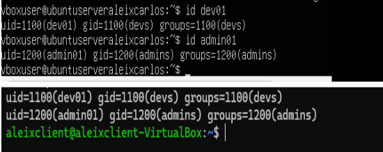
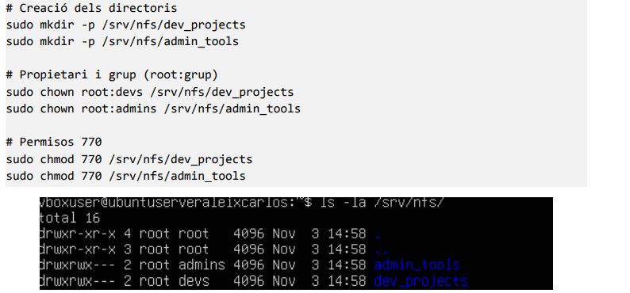
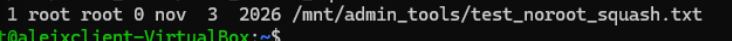
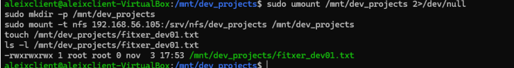
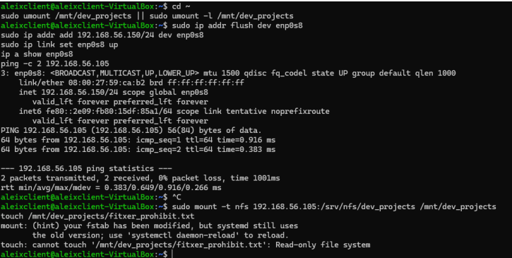
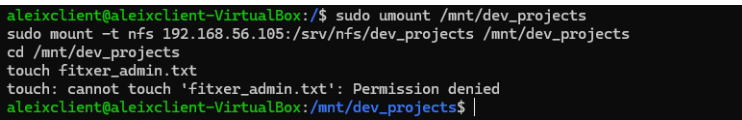
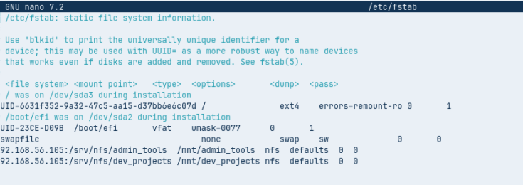

**AA1-NFS**

Compartició d'arxius i carpetes amb NFS

**Alumne:** Aleix Bueno Brugat

**Cicle:** CFGM Sistemes Microinformàtics i Xarxes (SMX)

**Assignatura:** Sistemes Operatius en Xarxa

**Cas pràctic:** DevOptimize Solutions

# **Introducció**

L'objectiu d'aquesta pràctica és muntar un servidor NFS que centralitzi els fitxers de dues àrees de l'empresa DevOptimize Solutions: l'equip de desenvolupament i l'equip d'administració. Així el codi font i la documentació tècnica deixen de estar escampats pels ordinadors de cadascú i queden en un únic punt, controlat i amb permisos.

Per fer-ho he treballat amb dues màquines virtuals a VirtualBox. Al servidor he exportat dues carpetes, una per a cada equip, i des del client he anat comprovant què passa amb diferents configuracions: l'efecte de root\_squash, la diferència entre rw i ro, i com els permisos locals del servidor poden tallar un accés que NFS sí permetria. Al final he deixat el muntatge automàtic configurat perquè el client ho tingui tot disponible en arrencar.

|  | Servidor | Client |
| :---- | :---- | :---- |
| Sistema operatiu | Ubuntu Server | Zorin OS 18 |
| IP (Host-Only) | 192.168.56.105 | 192.168.56.104 |
| Recursos NFS | /srv/nfs/dev\_projects | /mnt/dev\_projects |
|  | /srv/nfs/admin\_tools | /mnt/admin\_tools |

# **Fase 1: Preparació de l'entorn**

## **1.1. Configuració de xarxa de les màquines virtuals**

Cada màquina virtual té dues targetes de xarxa, cadascuna amb una funció diferent:

* **Adaptador 1 (NAT):** dona sortida a Internet. El necessito per descarregar i actualitzar paquets.

* **Adaptador 2 (Només amfitrió / Host-Only):** crea una xarxa privada entre el servidor i el client (rang 192.168.56.0/24). Per aquí passarà tot el trànsit NFS.

## **1.2. Comprovació de connectivitat i actualització**

Abans de tocar res d'NFS he mirat amb ip a les adreces de cada màquina (servidor 192.168.56.105, client 192.168.56.104) i he fet un ping des del client cap al servidor per assegurar-me que es veuen. Els quatre paquets han arribat sense pèrdues. També he actualitzat els paquets dels dos sistemes.
![Adreces IP del servidor (dalt) i del client (baix), i ping des del client al servidor.![][def]
***Captura 1\.** Adreces IP del servidor (dalt) i del client (baix), i ping des del client al servidor.*

# **Fase 2: Preparació del servidor**

## **2.1. Instal·lació del servei NFS**

Al servidor només cal instal·lar el paquet del servidor NFS del nucli:

sudo apt update  
sudo apt install nfs-kernel-server \-y

## **2.2. Creació de grups i usuaris (servidor i client)**

NFS no sap res dels noms d'usuari: el que compara són els números UID i GID. Com que no tinc cap sistema d'autenticació centralitzat, he creat els mateixos grups i usuaris, amb els mateixos números, tant al servidor com al client. Així l'usuari dev01 del client és el mateix dev01 del servidor.

\# Grups (al servidor i al client)  
sudo groupadd \-g 1100 devs  
sudo groupadd \-g 1200 admins  
   
\# Usuaris (al servidor i al client)  
sudo useradd \-u 1100 \-m \-g devs \-s /bin/bash dev01  
sudo useradd \-u 1200 \-m \-g admins \-s /bin/bash admin01

Ho he comprovat amb id a cada màquina.

![Sortida de id dev01 i id admin01 al servidor (dalt) i al client (baix).]

***Captura 2\.** Sortida de id dev01 i id admin01 al servidor (dalt) i al client (baix).*

## 

## 

## 

## 

## 

## 

## **2.3. Directoris i permisos locals**

He creat les dues carpetes a exportar dins de /srv/nfs. Cada una és de root i del grup que hi ha d'accedir, i amb permisos 770: el propietari i el grup poden llegir, escriure i entrar, i la resta no pot fer res.

\# Creació dels directoris  
sudo mkdir \-p /srv/nfs/dev\_projects  
sudo mkdir \-p /srv/nfs/admin\_tools  
   
\# Propietari i grup (root:grup)  
sudo chown root:devs /srv/nfs/dev\_projects  
sudo chown root:admins /srv/nfs/admin\_tools  
   
\# Permisos 770  
sudo chmod 770 /srv/nfs/dev\_projects  
sudo chmod 770 /srv/nfs/admin\_tools

***Captura 3\.** Llistat de /srv/nfs amb els propietaris, grups i permisos aplicats.*

# **Fase 3: L'exportació d'administració**

Aquí exporto /srv/nfs/admin\_tools dues vegades, amb una diferència: l'opció no\_root\_squash. L'objectiu és veure què fa NFS quan l'usuari root del client intenta escriure.

## **3.1. Prova 1: comportament per defecte (root\_squash)**

Primer he afegit l'exportació a /etc/exports sense indicar res sobre root. NFS aplica root\_squash per defecte, i per això no cal escriure-ho.

\# /etc/exports (servidor)  
/srv/nfs/admin\_tools 192.168.56.0/24(rw,sync,no\_subtree\_check)  
   
sudo exportfs \-ra

Des del client he muntat el recurs i he creat el fitxer test\_root\_squash.txt com a root (UID 0). El fitxer no ha quedat a nom de root: el servidor l'ha convertit a l'usuari anònim nobody:nogroup (UID 65534). És una protecció perquè el superusuari d'un client, que pot ser un ordinador qualsevol, no tingui els mateixos poders sobre els fitxers del servidor.

![Fitxer creat com a root al client: al servidor consta com a nobody nogroup.]

***Captura 4\.** Fitxer creat com a root al client: al servidor consta com a nobody nogroup.*

## **3.2. Prova 2: amb no\_root\_squash**

A la segona prova he afegit no\_root\_squash a l'exportació, he recarregat la configuració i he tornat a muntar el recurs al client.

\# /etc/exports (servidor)  
/srv/nfs/admin\_tools 192.168.56.0/24(rw,sync,no\_subtree\_check,no\_root\_squash)  
   
sudo exportfs \-ra

Aquesta vegada, el fitxer test\_noroot\_squash.txt creat com a root es queda amb propietari i grup root root. El servidor es fia de la identitat que li envia el client. Va bé quan un administrador necessita gestionar el recurs de veritat, però cal anar amb molt de compte en producció: si algú aconsegueix control sobre el client, tindrà accés de superusuari a aquesta carpeta del servidor.

![Fitxer creat com a root amb no\_root\_squash: es conserva root root.]

***Captura 5\.** Fitxer creat com a root amb no\_root\_squash: es conserva root root.*

# **Fase 4: L'exportació de desenvolupament (rw vs ro)**

## **4.1. Prova 1: lectura i escriptura (rw) per a tota la xarxa**

He exportat /srv/nfs/dev\_projects amb lectura i escriptura per a tota la subxarxa 192.168.56.0/24. Des del client (amb una IP dins del rang) l'he muntat i he creat fitxer\_dev01.txt sense cap problema. Per a un entorn de xarxa de confiança, és una configuració còmoda per treballar en equip.

\# /etc/exports (servidor)  
/srv/nfs/dev\_projects 192.168.56.0/24(rw,sync,no\_subtree\_check)  
   
\# Al client  
sudo mkdir \-p /mnt/dev\_projects  
sudo mount \-t nfs 192.168.56.105:/srv/nfs/dev\_projects /mnt/dev\_projects  
touch /mnt/dev\_projects/fitxer\_dev01.txt

![Muntatge de dev\_projects i creació de fitxer\_dev01.txt amb èxit.]

***Captura 6\.** Muntatge de dev\_projects i creació de fitxer\_dev01.txt amb èxit.*

## **4.2. Prova 2: només lectura (ro) per a una IP concreta**

Després he afegit una regla per a una IP concreta, la 192.168.56.150, amb l'opció ro. He canviat l'adreça IP del client a aquesta (comprovada amb ip a i amb un ping al servidor), he muntat el recurs i he intentat crear un fitxer. El servidor ho ha rebutjat amb l'error Read-only file system. Això permet donar només lectura a alguns equips concrets mentre la resta de la xarxa continua podent escriure.

\# /etc/exports (servidor)  
/srv/nfs/dev\_projects 192.168.56.0/24(rw,sync,no\_subtree\_check) 192.168.56.150(ro,sync,no\_subtree\_check)  
   
sudo exportfs \-ra

![IP del client canviada a 192.168.56.150, muntatge de dev\_projects i intent d'escriptura: Read-only file system.]

***Captura 7\.** IP del client canviada a 192.168.56.150, muntatge de dev\_projects i intent d'escriptura: Read-only file system.*

## **4.3. Prova 3: els permisos locals del servidor (UGO)**

Encara que NFS deixi escriure per xarxa (rw), el servidor continua aplicant els permisos normals del sistema de fitxers. La carpeta és 770 i del grup devs, així que un usuari que no hi pertanyi no pot crear res. He provat de fer un touch amb un usuari que no és del grup devs i he obtingut Permission denied. Els permisos locals tenen la darrera paraula i funcionen com una capa de seguretat addicional.

![Intent de crear un fitxer amb un usuari fora del grup devs: Permission denied.]

***Captura 8\.** Intent de crear un fitxer amb un usuari fora del grup devs: Permission denied.*

# **Fase 5: Muntatge automàtic amb /etc/fstab**

## **5.1. Edició de /etc/fstab al client**

Perquè el client tingui les dues carpetes muntades cada vegada que s'engega (Zorin OS), he afegit una línia per recurs al final de /etc/fstab:

192.168.56.105:/srv/nfs/admin\_tools  /mnt/admin\_tools  nfs  defaults  0  0  
192.168.56.105:/srv/nfs/dev\_projects /mnt/dev\_projects nfs  defaults  0  0

![Fitxer /etc/fstab del client amb les dues línies de muntatge NFS al final.]

***Captura 9\.** Fitxer /etc/fstab del client amb les dues línies de muntatge NFS al final.*

## **5.2. Comprovació després de reiniciar**

Després de desar el fitxer he recarregat la configuració (sudo systemctl daemon-reload) i he provat les línies noves (sudo mount \-a). Per acabar de comprovar-ho he reiniciat el client i, ja de nou dins del sistema, he executat df \-h \| grep nfs. Les dues carpetes apareixen muntades soles, sense haver fet res a mà.

***Captura 10\.** Sortida de df \-h \| grep nfs després de reiniciar el client.*

# 

# 

# 

# **Conclusions i recomanacions per a DevOptimize Solutions**

## **Avantatges de la solució**

* Tot el codi font i la documentació queden en un sol lloc de la xarxa local, i no repartits pels ordinadors de cada desenvolupador.

* No es depèn de cap proveïdor de núvol ni se'n paguen les quotes.

* Des de Linux, l'usuari treballa amb les carpetes muntades com si fossin locals.

## **Limitacions**

* La configuració que he fet no xifra el trànsit: les dades i els fitxers viatgen en clar per la xarxa. La seguretat es basa en l'adreça IP del client i en el UID/GID, que és fàcil de falsejar.

* Sense un sistema d'autenticació centralitzat, he hagut de crear usuaris i grups a mà a cada màquina amb els mateixos números. Amb quatre màquines és assumible, però en una empresa que creixi és lent i fàcil d'equivocar-s'hi.

* Els permisos UGO (propietari, grup, altres) són molt bàsics i costa fer-hi regles d'accés més complexes per a equips diferents.

## **Millores recomanades**

* **NFSv4 amb Kerberos:** afegeix autenticació segura i xifratge del trànsit, i permet fer servir ACL avançades.

* **Directori centralitzat (OpenLDAP o Active Directory):** gestiona usuaris i grups des d'un únic lloc i fa que els UID/GID coincideixin a tota la xarxa de manera automàtica.

* **Repositori Git intern (per exemple GitLab CE):** per al codi, és millor que una carpeta compartida, perquè evita els conflictes quan dues persones editen el mateix fitxer alhora i guarda l'historial de canvis.

[def]: /img/cap1.png
[def2]: /img/cap10.png